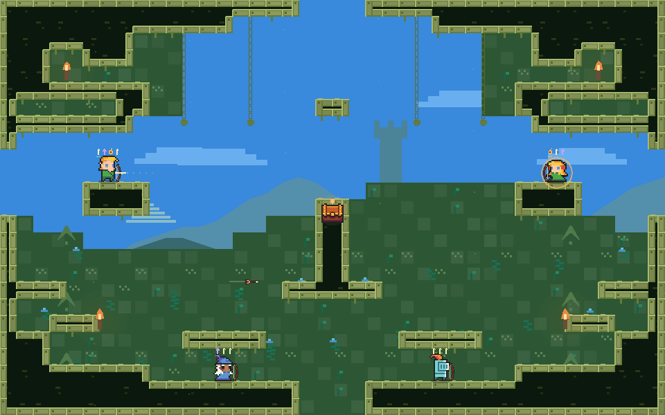
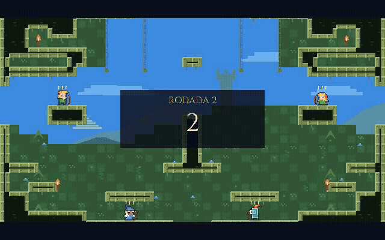
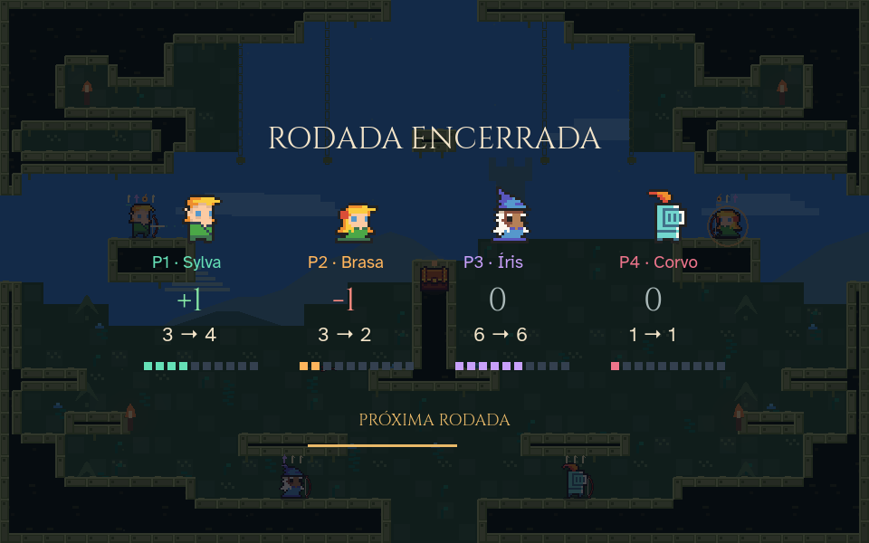
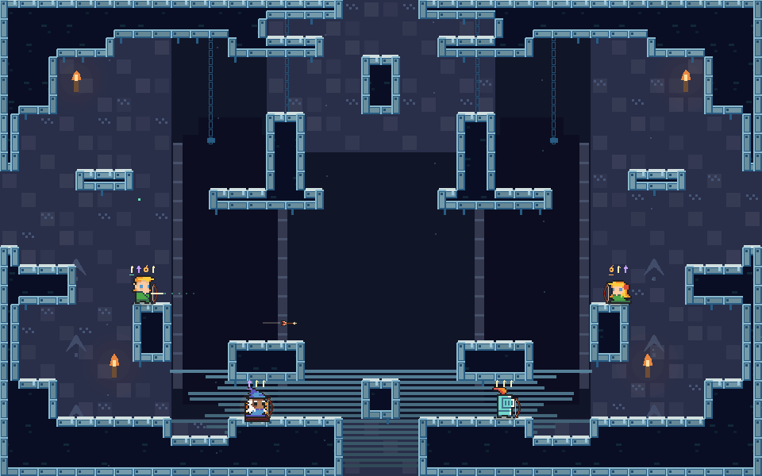
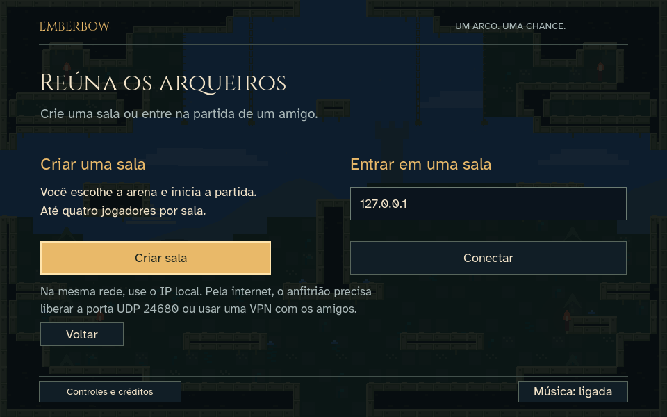

# Emberbow — Arena Online

**Um arco. Uma chance.** Arena de combate 2D em pixel art, feita em **Godot 4.5.1**, inspirada em TowerFall: munição limitada, captura de flechas com dash, pisões e partidas rápidas.

Treino com bot · Duelo local · Online por IP para 2–4 jogadores · Teclado, mouse e controle



> Projeto independente em desenvolvimento, sem afiliação com TowerFall. As mecânicas e o visual são uma implementação própria; não é uma reprodução integral do jogo original.

## Veja em movimento

[](docs/media/emberbow-demo.mp4)

**[Assistir/baixar vídeo MP4 com áudio](docs/media/emberbow-demo.mp4)** · [Download direto](../../raw/main/docs/media/emberbow-demo.mp4)

Demonstração roteirizada, renderizada pelo próprio Godot. Mostra entrada da rodada, movimento, flechas, pontuação e troca de arena. Os totais apresentados na demonstração são ilustrativos; não é gravação de uma partida entre quatro pessoas.

## O que já funciona

- Quatro personagens selecionáveis e seis arenas com rotas diferentes.
- Combate sem HUD permanente: o inventário fica sobre cada personagem.
- Um acerto elimina. Saltar sobre o adversário também elimina e rebate o atacante.
- Pulo variável, buffer de pulo e tolerância curta após sair da plataforma.
- Agarrar na parede, salto na parede e correção de quinas no pulo/dash.
- Dash com captura de flechas, efeitos de impacto e recarga.
- Flechas normais, perfurantes e explosivas no mesmo inventário.
- Coleta automática de flechas do chão e das paredes.
- Passagem entre bordas: sair por baixo leva ao topo, e sair pela direita leva à esquerda.
- Contagem antes da rodada, saldo e total de pontos entre rodadas, avanço automático.
- Música e efeitos sonoros; trepidação de impacto pode ser desativada.
- Controle com mira independente, navegação dos menus e detecção de conexão/desconexão.

## Instalar e executar

### Requisitos

- [Godot 4.5.1](https://godotengine.org/download/archive/4.5.1-stable/) — edição padrão, sem necessidade de .NET.
- Git para clonar, ou use **Code → Download ZIP** no GitHub.
- Python 3 apenas para executar o teste de rede.

```sh
git clone https://github.com/AbnerSilvaBarbosa/emberbow.git
cd emberbow
godot --editor --path .
```

No gerenciador do Godot, também é possível escolher **Importar**, selecionar `project.godot` e pressionar **F5** para jogar. A cena inicial é `scenes/main.tscn`. Não há addons obrigatórios.

**macOS:** `Jogar.command` procura o Godot em `/Applications/Godot.app` ou `.tools/Godot.app`. O motor não é incluído no repositório. Se o executável estiver em outro local, importe o projeto pelo editor.

**Windows/Linux:** importe o projeto no editor do Godot. Não há builds exportadas nem validação física nessas plataformas nesta versão.

## Modos de jogo

| Modo | Jogadores | Como iniciar |
|---|---:|---|
| Treino | Você + bot | Escolha **Treinar contra bot** |
| Duelo local | 2 no mesmo computador | Escolha **Duelo no mesmo computador** |
| Online | 2–4 | Um jogador cria a sala; os demais entram pelo IP |

Selecione o arqueiro e a arena no menu antes de começar.


## Regras e fluxo de rodada

1. Cada jogador nasce com três flechas normais.
2. A contagem termina e o combate começa, sem placar ocupando a tela.
3. Cada eliminação soma um ponto ao atacante. Autoeliminação tira um ponto, sem total negativo.
4. A rodada termina quando resta no máximo um jogador vivo.
5. O placar mostra o saldo de cada um (`+1`, `−1`, `0` etc.) e a mudança do total.
6. Após 3,4 segundos, começa a próxima rodada. Ao chegar a dez pontos, aparece o resultado final.

Após 40 segundos de combate, uma névoa fecha as laterais para evitar impasses.



## Controles

### Teclado e mouse

| Ação | P1 / online | P2 local |
|---|---|---|
| Mover / mirar | WASD | Setas |
| Pular | Espaço | Enter / Numpad 0 |
| Segurar mira e soltar tiro | J / mouse esquerdo | Shift / Numpad 1 |
| Dash / capturar | K / mouse direito | Ctrl / Numpad 2 |
| Detonar explosivas | L | Backspace / Numpad 3 |
| Alternar próxima flecha | R | Ponto (`.`) |
| Pausa / menu | Esc | — |
| Música | M | — |
| Tela cheia | F11 | — |

Mover o mouse ativa temporariamente a mira pelo cursor. Sem uma nova direção, o personagem conserva a última mira. Soltar o pulo cedo reduz sua altura. Segurar a direção contra uma parede mantém o personagem agarrado; solte para cair ou pule para saltar para fora.

### Controle

Nomes no padrão Xbox; os botões equivalentes dependem do mapeamento reconhecido pelo Godot/SDL.

| Ação | Botão / eixo |
|---|---|
| Mover | Analógico esquerdo ou D-pad |
| Mirar independentemente | Analógico direito |
| Pular | A — botão inferior |
| Dash | B — botão direito — ou LB |
| Segurar e soltar tiro | X — botão esquerdo — ou RT |
| Detonar explosivas | Y — botão superior |
| Alternar flecha | RB |
| Pausa | Start |
| Navegar / confirmar / voltar nos menus | Direcional / A / B |

**Atribuição automática:** no treino/online, o primeiro controle comanda você. No duelo local, um controle comanda P2 e deixa P1 no teclado; com dois controles, o primeiro comanda P1 e o segundo P2. Os teclados continuam disponíveis.

Desconectar um controle abre o menu. No jogo local, isso pausa; online, os demais continuam jogando. Os testes de controle usam eventos sintetizados: compatibilidade com modelos físicos, USB e Bluetooth ainda precisa de playtest.

## Flechas e inventário

| Tipo | Identificação | Comportamento |
|---|---|---|
| Normal | Haste clara | Para no cenário; pode ser recolhida |
| Perfurante | Ponta triangular roxa | Atravessa o cenário |
| Explosiva | Bomba laranja | Detona sob comando; pode atingir o próprio dono |

Capacidade máxima: **seis flechas**. A próxima fica sublinhada. Coleta e captura preservam o tipo; baús dão duas especiais. Encoste em uma flecha parada para recolhê-la, se houver espaço. Jogadores eliminados deixam a munição restante.

## Arenas

| Arena | Estrutura |
|---|---|
| Ruínas da Aurora | Ruínas verdes, nichos laterais e obelisco central |
| Forja Suspensa | Balcões em gancho, túneis e paredes altas |
| Jardim Lunar | Variação verde com apoios adicionais e rotas elevadas |
| Abismo Astral | Eixo central e circuitos laterais |
| Torres Gêmeas | Pedra azul, duas torres e rotas inferiores |
| Coroa Partida | Cripta com plataformas centrais adicionais |

O desenho e a colisão compartilham uma grade de 24 px. Pedra com contorno claro é sólida; paredes decorativas ao fundo não bloqueiam o movimento. As aberturas nas bordas permitem circular entre extremos.



## Jogar online

1. O anfitrião escolhe **Jogar online → Criar sala**.
2. Compartilha seu IP com os convidados.
3. Os convidados informam esse IP e escolhem **Conectar**.
4. Com 2–4 participantes, o anfitrião inicia a partida.

- Na mesma máquina, use `127.0.0.1`.
- Na mesma rede, use o IP local do anfitrião.
- Pela internet, o anfitrião precisa disponibilizar **UDP 24680**, usando encaminhamento de porta/IP acessível ou VPN entre os participantes.

A rede usa **ENet com host autoritativo**, comandos a 60 Hz e snapshots a 30 Hz, com suavização visual. Ainda não há rollback, predição, servidor público, códigos de convite ou travessia automática de NAT. Latência alta afeta a resposta dos convidados. Não aceitamos entrada de novos jogadores durante uma partida.



## Desenvolvimento e testes

```text
scripts/
  main.gd           Simulação, combate, rodadas e rede
  player.gd         Movimento, inventário e apresentação do arqueiro
  gamepad.gd        Mapeamento e atribuição de controles
  arena_layouts.gd  Geometria das seis arenas e pontos de nascimento
  arena_world.gd    Desenho do cenário em pixel art
  art.gd            Sprites, efeitos e composição visual
  interface.gd      Menus e transições de rodada
assets/             Sprites, fontes e licenças
audio/              Música e efeitos sintetizados
scenes/             Cena inicial
tests/              Regressões, captura e demonstração
docs/               Pesquisa, validação e mídia
```

Importe antes de rodar os testes:

```sh
godot --headless --path . --editor --import --quit
```

Cada teste termina com código diferente de zero em caso de falha:

```sh
godot --headless --path . --script tests/combat.gd
godot --headless --path . --script tests/mechanics.gd
godot --headless --path . --script tests/inventory_wrap.gd
godot --headless --path . --script tests/wall_pickup.gd
godot --headless --path . --script tests/round_flow.gd
godot --headless --path . --script tests/corners.gd
godot --headless --path . --script tests/gamepad.gd
godot --headless --path . --script tests/ui_click.gd
python3 tests/network.py /caminho/para/godot
```

**Validação registrada:** 105 verificações de mecânicas/controle, clique de interface e host + três clientes ENet em localhost. Veja [resultados e limitações](docs/VALIDATION.md).

Não validados: internet pública, perda/jitter, controles físicos, builds exportadas e balanceamento prolongado.

### Reproduzir as mídias

```sh
godot --path . --script tests/capture.gd
godot --path . --script tests/demo.gd --write-movie /tmp/emberbow-demo.avi --fixed-fps 30
```

As capturas usam uma cena de demonstração para apresentar inventários e resultados. O vídeo usa comandos roteirizados. As mídias são geradas pelo jogo, não mockups.

## Créditos e referências

- Sprites: **Dungeon Tileset II, 0x72 — CC0**.
- Assets Gothicvania: **Ansimuz — CC0**, disponíveis no projeto; as arenas atuais são desenhadas em código.
- Fontes: **Cinzel e Atkinson Hyperlegible — OFL**.
- Música e efeitos sintetizados; cenário e implementação próprios.
- Correção de quinas inspirada no controlador CC0 de markolainen, reimplementada para Godot 4.

[Créditos e licenças dos assets](assets/licenses/CREDITS.md) · [Pesquisa do jogo](docs/RESEARCH.md) · [Código aberto estudado](docs/OPEN_SOURCE.md) · [Direção visual](DESIGN.md)

As licenças de terceiros estão preservadas em `assets/licenses/`. Nenhuma licença geral de redistribuição foi definida para o código autoral neste repositório.
