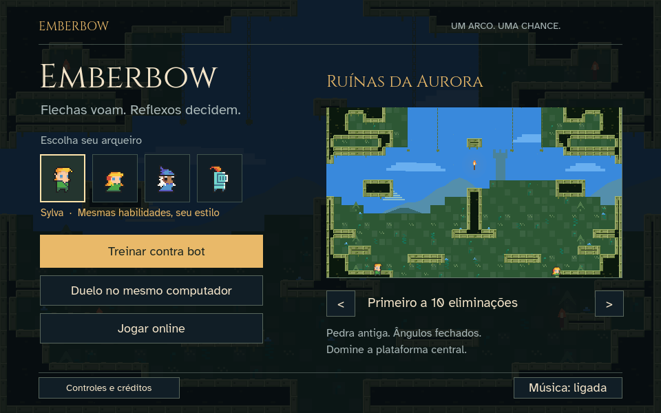

# Instalar e jogar no Windows

Este guia usa o código-fonte do Emberbow e o Godot 4.5.1 padrão. Não há instalador Windows pronto nesta versão. O projeto foi validado no macOS; a execução física no Windows ainda precisa de teste.

## 1. Baixar o jogo

1. Abra [o repositório](https://github.com/AbnerSilvaBarbosa/emberbow).
2. Clique em **Code → Download ZIP**.
3. Clique com o botão direito no ZIP e escolha **Extrair Tudo**.
4. Salve em uma pasta como `C:\Jogos\emberbow`. Nela deve existir `project.godot`.

Não abra o projeto diretamente dentro do ZIP. Se preferir Git:

```powershell
git clone https://github.com/AbnerSilvaBarbosa/emberbow.git C:\Jogos\emberbow
```

## 2. Baixar o Godot

1. Acesse o [download oficial do Godot 4.5.1](https://godotengine.org/download/archive/4.5.1-stable/).
2. Escolha **Standard → Windows → x86_64** para um PC comum Intel/AMD de 64 bits. Em um PC ARM, escolha a versão correspondente.
3. Extraia o ZIP do Godot em uma pasta como `C:\Ferramentas\Godot`.
4. Execute o arquivo do editor, por exemplo `Godot_v4.5.1-stable_win64.exe`.

A edição .NET não é necessária: o jogo usa GDScript. O Godot é portátil e não exige instalação tradicional.

## 3. Abrir e jogar

1. No gerenciador de projetos do Godot, clique em **Importar / Import**.
2. Selecione `C:\Jogos\emberbow\project.godot`.
3. Abra o projeto e aguarde a importação de sprites, fontes e sons.
4. Pressione **F5** ou o botão de executar projeto.
5. Escolha **Treinar contra bot**, **Duelo no mesmo computador** ou **Jogar online**.



`Jogar.command` é exclusivo do macOS. No Windows, use o editor ou os comandos abaixo.

### Iniciar sem abrir o editor

No PowerShell, ajuste os caminhos para suas pastas:

```powershell
$godotExe = 'C:\Ferramentas\Godot\Godot_v4.5.1-stable_win64.exe'
$gameFolder = 'C:\Jogos\emberbow'

# Necessário na primeira execução e após atualizar assets.
& $godotExe --headless --path $gameFolder --editor --import --quit

# Abre a janela do jogo.
& $godotExe --path $gameFolder
```

O primeiro comando apenas importa os recursos; não abre uma sala online.

## 4. Teclado e controle

| Ação | Teclado P1 | Controle, padrão Xbox |
|---|---|---|
| Mover | WASD | Analógico esquerdo / D-pad |
| Mirar | WASD / movimento do mouse | Analógico direito |
| Pular | Espaço | A |
| Atirar ao soltar | J / mouse esquerdo | X / RT |
| Dash e captura | K / mouse direito | B / LB |
| Detonar | L | Y |
| Trocar flecha | R | RB |
| Pausa | Esc | Start |

Nos menus: direcional navega, A confirma e B volta. Conecte o controle por USB ou emparelhe pelo Windows antes de jogar. No treino/online, o primeiro controle comanda você. No duelo local, um controle fica com P2; dois controles comandam P1 e P2 separadamente. Consulte [todos os controles](../README.md#controles) para o segundo teclado e atalhos.

O reconhecimento depende do mapeamento oferecido pelo Godot/SDL. Botões e vibração ainda não foram validados em dispositivos físicos.

## 5. Jogar com amigos

Use o [guia de hospedagem](SERVER.md). O anfitrião abre **Jogar online → Criar sala**, compartilha seu IP e inicia quando os convidados entrarem. O jogo usa **UDP 24680**.

## 6. Gerar um executável para distribuir

Esta etapa é para quem quer produzir uma build. As pessoas que receberem a build não precisarão instalar o Godot.

1. Abra o projeto no Godot 4.5.1.
2. Abra **Editor → Manage Export Templates / Gerenciar modelos de exportação**.
3. Instale os templates da mesma versão do editor.
4. Abra **Project → Export / Projeto → Exportar**.
5. Adicione um preset **Windows Desktop**, arquitetura x86_64 para PCs Intel/AMD de 64 bits.
6. Exporte o projeto para uma pasta separada, por exemplo `build/windows/Emberbow.exe`.
7. Se a exportação gerar `Emberbow.pck`, distribua esse arquivo junto do `.exe`, na mesma pasta. Se ativar **Embed PCK**, os recursos ficam incorporados no executável.
8. Inclua os créditos e licenças de `assets/licenses/` na distribuição.
9. Teste o executável exportado em outro PC Windows antes de distribuir o ZIP.

Não há preset Windows versionado nem build assinada neste repositório. O guia descreve a exportação pelo editor; ele não confirma que uma build Windows foi gerada/testada.

## Problemas comuns

| Sintoma | O que conferir |
|---|---|
| Não encontro `project.godot` | Extraia o ZIP e entre na pasta do projeto, não na pasta do Godot |
| Não abre pelo `Jogar.command` | Esse arquivo é do macOS; use F5 ou o PowerShell acima |
| Sprite/som ausente depois de atualizar | Reabra o editor e aguarde a importação |
| Tela preta ou erro gráfico | Atualize o driver de vídeo; o projeto já usa o renderer Compatibility |
| Controle não responde | Confira se o Windows reconhece o dispositivo; teste USB e reveja a atribuição P1/P2 |
| Sala não conecta | Confira o IP, a porta UDP, firewall e o guia de servidor |
| Versões diferentes entre amigos | Todos devem baixar a mesma revisão do jogo |

## Atualizar

Com Git, feche o jogo e execute `git pull` na pasta do projeto. Se houver alterações locais, preserve-as antes de atualizar. Pelo ZIP, extraia a nova versão em outra pasta. Reabra no Godot para importar os recursos.

## Fontes oficiais

- [Download do Godot 4.5.1](https://godotengine.org/download/archive/4.5.1-stable/).
- [Exportar para Windows — Godot 4.5](https://docs.godotengine.org/en/4.5/tutorials/export/exporting_for_windows.html).
